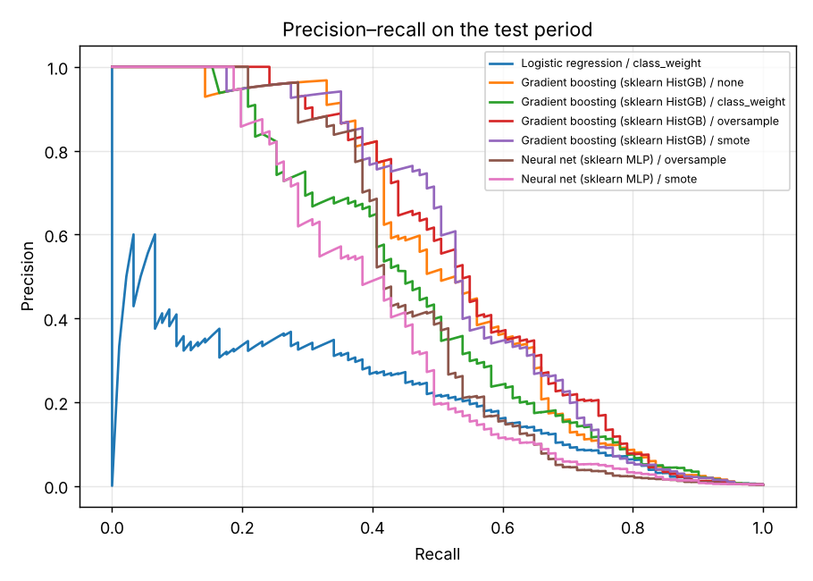

# UPI / credit-card fraud detection: explainable, cost-aware, real time

**Author:** [Sharbesh S](https://github.com/SharbeshS8199) · MIT License

Detects fraudulent UPI payments when only about 0.3% of transactions are fraud. It compares
**gradient boosting (XGBoost) against neural networks** across **four ways of handling class
imbalance**, picks decision thresholds by **₹ cost rather than accuracy**, explains every alert in
plain English, and serves predictions through a **real-time API** (p50 6 ms, p99 17 ms on a 2-core CPU).

```json
POST /score  {"amount": 18500, "hour": 2, "channel": "collect", "amount_to_avg_30d": 14.2, "sim_swap_last_48h": 1, ...}
→ {"fraud_probability": 0.965, "decision": "block",
   "reasons": ["amount is far above this user's usual spend",
               "many transactions in the last hour", "unusually large amount"]}
```

## Dashboard

```bash
pip install -e '.[dashboard]'      # streamlit + plotly
streamlit run dashboard/app.py
```

Model comparison and precision–recall curves · a **threshold explorer** (drag the slider, watch precision, recall and ₹ savings move) · a live transaction feed with allow/review/block decisions · a form to score any transaction with its top reasons · what drives alerts.

## Why this is harder than it looks

- **Accuracy is meaningless.** Flagging nothing at all is 99.7% accurate. This repo reports
  **PR-AUC**, recall and precision at the chosen threshold, and **₹ of fraud caught**.
- **Random splits leak the future.** Data is split **chronologically**: train on the past,
  validate on the next period, test on the latest.
- **The threshold is a business decision.** A ₹30 manual review versus a ₹18,000 loss gives two tiers:
  **review** at the threshold that maximises net savings on validation, and **auto-block** only
  where validation precision is at least 90%.
- **"Why was my payment blocked?"** Every alert carries its top reasons. SHAP plots are included
  for the model as a whole.

## Results (synthetic UPI data, 200k transactions, 0.3% fraud)

Real UPI data is never public, so `fraud/data.py` simulates users, devices, payees and four
documented scam patterns: SIM-swap account takeover, fake "collect" requests, mule accounts and
rapid draining. It also simulates **genuine users who trip the same signals** (new phone, new shop,
big purchase, travel), so the classes overlap the way they do in practice. Reproduce with
`python -m fraud.train`.

| Model | Imbalance handling | Test PR-AUC | ROC-AUC | Recall | Fraud ₹ caught | Alerts / 1k txns |
|---|---|---|---|---|---|---|
| Logistic regression | class weights | 0.219 | 0.938 | 0.714 | 89.9% | 23.8 |
| Gradient boosting | none | 0.531 | 0.949 | 0.813 | 95.0% | 33.2 |
| Gradient boosting | class weights | 0.465 | 0.951 | 0.813 | 95.4% | 42.1 |
| Gradient boosting | random oversampling | **0.551** | 0.934 | 0.769 | 93.4% | **19.4** |
| Gradient boosting | SMOTE | 0.548 | 0.943 | 0.780 | 92.2% | 35.5 |
| Neural net (MLP) | random oversampling | 0.463 | 0.913 | 0.714 | 87.3% | 50.9 |
| Neural net (MLP) | SMOTE | 0.405 | 0.912 | 0.494 | 58.6% | 6.9 |

On the test period, the **block** tier stopped 18 transactions, 17 of them fraud. **Review** flagged
978 (57 fraud), and 17 of 91 frauds got through. This run used scikit-learn's HistGradientBoosting
and MLP. Install `.[full]` and the same script uses **XGBoost** and a **PyTorch MLP with focal loss**
instead. Full table, curves and explanations: [`reports/REPORT.md`](reports/REPORT.md).

**Talking points this table backs up:**
1. Gradient boosting beats both the linear model and the neural net on tabular data (2.4× the
   PR-AUC of logistic regression).
2. **Class weights reduced PR-AUC** for boosting (0.531 → 0.465). Re-weighting makes scores
   over-confident on positives, and gains in ROC-AUC hide that. Resampling helped slightly.
3. ROC-AUC barely separates the models (0.91–0.95) while PR-AUC differs by more than 2×. That's
   why PR-AUC is the right metric under heavy imbalance.
4. The test set has only 91 frauds, so differences of ±0.02 are within noise. Choose models on
   validation and don't over-read the test set. (That's what the code does.)



## Quickstart

```bash
pip install -e '.[dev]'
python -m fraud.train                       # ~1 min: comparison table, model, report, plots
python -m fraud.simulate --n 2000           # replay a live stream: latency + decisions
pytest

pip install -e '.[api]' && uvicorn app.api:app --port 8000    # docs at http://localhost:8000/docs
pip install -e '.[full]' && python -m fraud.train && python -m fraud.explain   # XGBoost, torch MLP, SHAP plots
```

**On the public Kaggle credit-card dataset** (284,807 transactions, 0.17% fraud): download
`creditcard.csv` from Kaggle (`mlg-ulb/creditcardfraud`) into `data/`, then run
`python -m fraud.train --data creditcard`.

## Design

```
transaction ─► features (log-scaled amounts, velocity, device/SIM, payee risk, one-hot categories)
            ─► model (selected on validation PR-AUC)
            ─► p ≥ block threshold?  → BLOCK   (validation precision ≥ 90%)
               p ≥ review threshold? → REVIEW  (maximises ₹ saved − ₹30 × alerts)
               else                  → ALLOW
            ─► reasons: change in log-odds when each feature is reset to its typical value
               (one batched call: p99 dropped from 139 ms to 17 ms after batching)
```

```
src/fraud/  data.py (generator, Kaggle loader, time split)   modeling.py (features, SMOTE, models, thresholds, explanations)
            train.py (experiments + report)   simulate.py (stream replay)   explain.py (SHAP)   torch_mlp.py (focal loss)
app/api.py  FastAPI /score with request validation
tests/      generator, no look-ahead split, SMOTE, cost threshold, end-to-end scoring
```
