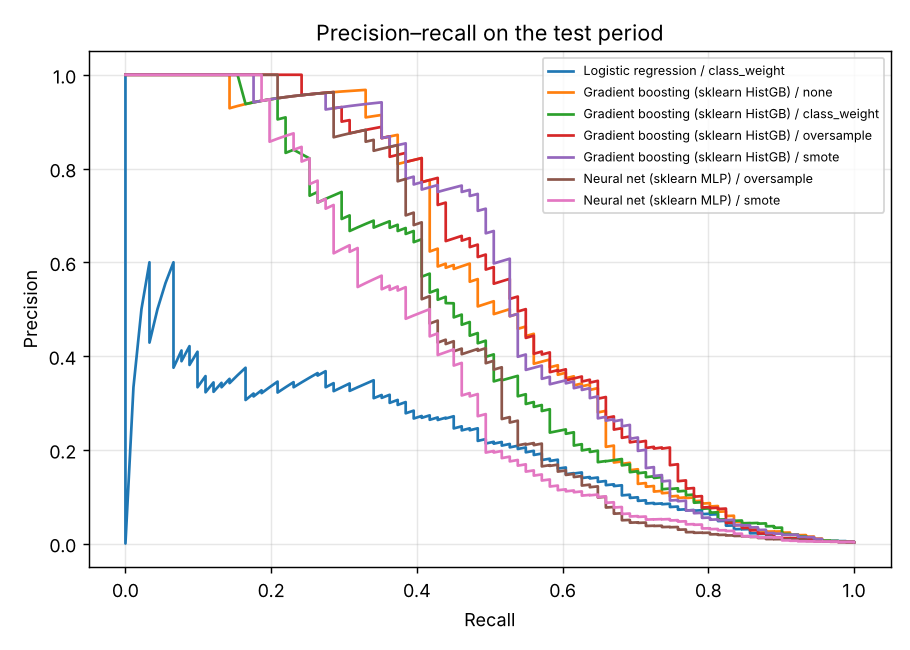
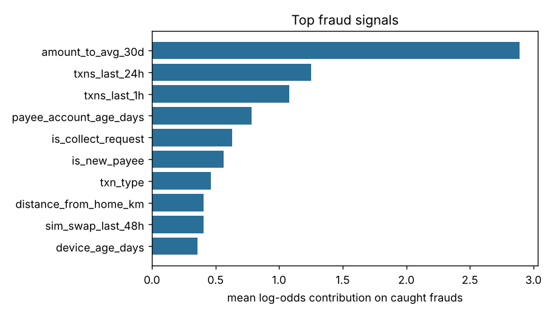

# Fraud detection results

Data: **upi**, 200,000 transactions, fraud rate 0.300%. Chronological split train/val/test = 140,000/30,000/30,000. Review threshold chosen on validation to maximise net savings (₹30 per manual review).

| Model | Imbalance handling | Val PR-AUC | Test PR-AUC | Test ROC-AUC | Precision | Recall | Fraud ₹ caught | Alerts per 1k txns | Train s |
|---|---|---|---|---|---|---|---|---|---|
| Logistic regression | class_weight | 0.252 | 0.219 | 0.938 | 0.091 | 0.714 | 89.9% | 23.8 | 0.2 |
| Gradient boosting (sklearn HistGB) | none | 0.496 | 0.531 | 0.949 | 0.074 | 0.813 | 95.0% | 33.2 | 2.1 |
| Gradient boosting (sklearn HistGB) | class_weight | 0.370 | 0.465 | 0.951 | 0.059 | 0.813 | 95.4% | 42.1 | 3.0 |
| Gradient boosting (sklearn HistGB) | oversample | 0.488 | 0.551 | 0.934 | 0.120 | 0.769 | 93.4% | 19.4 | 7.6 |
| Gradient boosting (sklearn HistGB) | smote | 0.458 | 0.548 | 0.943 | 0.067 | 0.780 | 92.2% | 35.5 | 7.7 |
| Neural net (sklearn MLP) | oversample | 0.338 | 0.463 | 0.913 | 0.043 | 0.714 | 87.3% | 50.9 | 8.5 |
| Neural net (sklearn MLP) | smote | 0.339 | 0.405 | 0.912 | 0.217 | 0.494 | 58.6% | 6.9 | 12.0 |

**Selected (best validation PR-AUC):** Gradient boosting (sklearn HistGB) + none

Decision tiers on the test period:

| Decision | Transactions | of which fraud |
|---|---|---|
| block | 18 | 17 |
| review | 978 | 57 |
| allow | 29,004 | 17 |

## What drives the alerts

Mean log-odds contribution on caught frauds:

| Feature | Contribution |
|---|---|
| amount_to_avg_30d | 2.89 |
| txns_last_24h | 1.25 |
| txns_last_1h | 1.08 |
| payee_account_age_days | 0.78 |
| is_collect_request | 0.63 |
| is_new_payee | 0.56 |
| txn_type | 0.46 |
| distance_from_home_km | 0.41 |
| sim_swap_last_48h | 0.40 |
| device_age_days | 0.36 |

## Example explanations

- `T00170199` (p=0.0085): amount is far above this user's usual spend; it is a collect (payment request) approval; far from the user's usual location
- `T00170941` (p=0.9229): amount is far above this user's usual spend; payee account was opened very recently; first payment to this payee
- `T00171026` (p=0.6252): amount is far above this user's usual spend; it is a collect (payment request) approval; first payment to this payee

